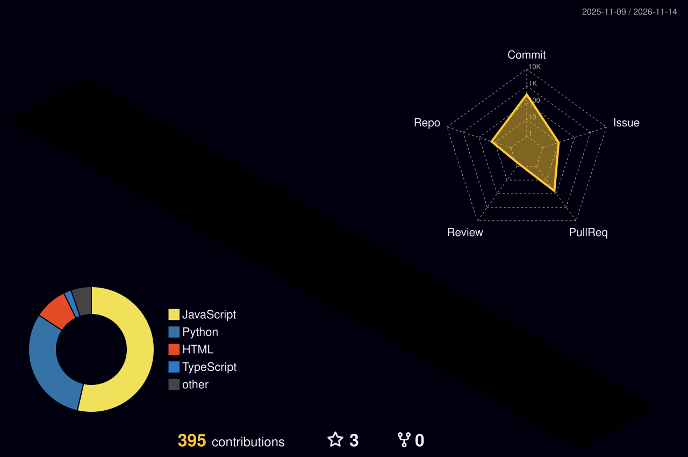
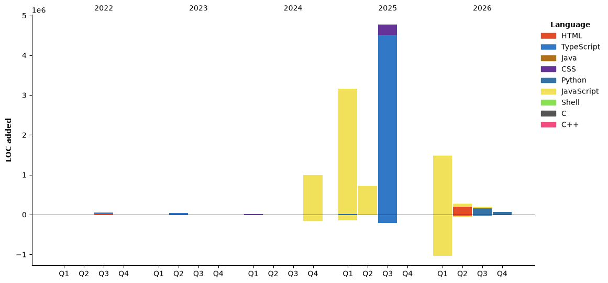

<div align="center">


<a href="https://github.com/Sinha28Shivam">
  
</a>


<br/>

<a href="https://portfolio-shivam-sinha.netlify.app/" target="_blank">
  
</a>

</div>


<br clear="both"/>

## 🚀 Tech Stack

**Core Development**

<div align="center">
  
</div>

**Automation & Game Testing**

<div align="center">
  
</div>

**AI / ML • Generative AI • Agentic AI**

<div align="center">
  
  
  
  
  
  
  
  
  
</div>

<br/>

## 🌱 Currently Learning / Roadmap

- 🤖 Deep-diving into **AI/ML fundamentals** — model training, evaluation, and deployment
- ✨ Building with **Generative AI** — prompt engineering, RAG pipelines, and LLM apps
- 🧠 Exploring **Agentic AI** — multi-agent systems with LangGraph & AutoGen
- 🧪 Sharpening **automation testing** skills with Appium across mobile platforms
- 📚 Next up: fine-tuning open-source models and shipping an end-to-end agentic project

## 💬 Quote of the Day

<div align="center">
  
</div>

## 📊 GitHub Stats

<div align="center">
  
  
</div>

<div align="center">
  
</div>

## 🔥 Streak Stats

<div align="center">
  
</div>

## 🏆 Trophies

<div align="center">
  
</div>

## 📌 Featured Projects

<div align="center">

| Project | Description | Tech |
|---|---|---|
| [**Portfolio**](https://github.com/Sinha28Shivam/Portfolio) | Personal developer portfolio site |  |
| [**RealTimeChat**](https://github.com/Sinha28Shivam/RealTimeChat) | Real-time chat application |  |
| [**Portfolio_website**](https://github.com/Sinha28Shivam/Portfolio_website) | Portfolio website project |  |
| [**Url_shortner**](https://github.com/Sinha28Shivam/Url_shortner) | URL shortening service |  |

</div>

## 🐍 Contribution Snake

<div align="center">
  
</div>

## 🏙️ 3D Contribution Skyline

<div align="center">
  
</div>

## ⏱️ Weekly Coding Activity (WakaTime)

<!--START_SECTION:waka-->


**🐱 My GitHub Data** 

> 📦 227.3 kB Used in GitHub's Storage 
 > 
> 🏆 395 Contributions in the Year 2026
 > 
> 🚫 Not Opted to Hire
 > 
> 📜 44 Public Repositories 
 > 
> 🔑 15 Private Repositories 
 > 
**I'm an Early 🐤** 

```text
🌞 Morning                458 commits         ████░░░░░░░░░░░░░░░░░░░░░   14.54 % 
🌆 Daytime                1249 commits        ██████████░░░░░░░░░░░░░░░   39.66 % 
🌃 Evening                723 commits         ██████░░░░░░░░░░░░░░░░░░░   22.96 % 
🌙 Night                  719 commits         ██████░░░░░░░░░░░░░░░░░░░   22.83 % 
```
📅 **I'm Most Productive on Sunday** 

```text
Monday                   585 commits         █████░░░░░░░░░░░░░░░░░░░░   18.58 % 
Tuesday                  327 commits         ███░░░░░░░░░░░░░░░░░░░░░░   10.38 % 
Wednesday                527 commits         ████░░░░░░░░░░░░░░░░░░░░░   16.74 % 
Thursday                 489 commits         ████░░░░░░░░░░░░░░░░░░░░░   15.53 % 
Friday                   427 commits         ███░░░░░░░░░░░░░░░░░░░░░░   13.56 % 
Saturday                 104 commits         █░░░░░░░░░░░░░░░░░░░░░░░░   03.30 % 
Sunday                   690 commits         █████░░░░░░░░░░░░░░░░░░░░   21.91 % 
```


📊 **This Week I Spent My Time On** 

```text
🕑︎ Time Zone: Asia/Kolkata

💬 Programming Languages: 
Python                   3 hrs 16 mins       █████████░░░░░░░░░░░░░░░░   36.44 % 
Markdown                 2 hrs 28 mins       ███████░░░░░░░░░░░░░░░░░░   27.49 % 
Other                    41 mins             ██░░░░░░░░░░░░░░░░░░░░░░░   07.73 % 
YAML                     41 mins             ██░░░░░░░░░░░░░░░░░░░░░░░   07.66 % 
TeX                      27 mins             █░░░░░░░░░░░░░░░░░░░░░░░░   05.12 % 

🔥 Editors: 
Copilot CLI              5 hrs 54 mins       ████████████████░░░░░░░░░   65.79 % 
VS Code                  2 hrs 38 mins       ███████░░░░░░░░░░░░░░░░░░   29.38 % 
Codex Vscode             13 mins             █░░░░░░░░░░░░░░░░░░░░░░░░   02.55 % 
Copilot                  12 mins             █░░░░░░░░░░░░░░░░░░░░░░░░   02.28 % 

🐱‍💻 Projects: 
AI_Hackathon_2.0         3 hrs 16 mins       █████████░░░░░░░░░░░░░░░░   36.38 % 
ps5-Arudino              3 hrs 12 mins       █████████░░░░░░░░░░░░░░░░   35.66 % 
ScrapFolder              1 hr 33 mins        ████░░░░░░░░░░░░░░░░░░░░░   17.28 % 
xboxArudino              32 mins             █░░░░░░░░░░░░░░░░░░░░░░░░   05.98 % 
Sinha28Shivam            25 mins             █░░░░░░░░░░░░░░░░░░░░░░░░   04.70 % 

💻 Operating System: 
Windows                  8 hrs 59 mins       █████████████████████████   100.00 % 
```

🤖 **AI Coding This Week** 

```text
⏱ AI Coding Time: 8 hrs 35 mins (95.55%)

✍️ 2,887 lines written by AI, 5 lines written by hand (99.83% AI-written)

🔤 71,701,196 Input Tokens, 209,095 Output Tokens

💵 $462.07 Estimated AI Cost This Week

🧠 15 AI Sessions, 96 AI Prompts

Opus                     1,824 lines         ████████████████░░░░░░░░░   63.01 % 
GPT                      1,071 lines         █████████░░░░░░░░░░░░░░░░   36.99 % 
Vscode                   0 lines             ░░░░░░░░░░░░░░░░░░░░░░░░░   00.00 % 
Cline-Cli                0 lines             ░░░░░░░░░░░░░░░░░░░░░░░░░   00.00 % 

🔎 AI Coding Insights:
🤖 AI-Driven — 99.83% of written lines came from AI
📄 Detailed Prompter — average 617 characters per prompt
🔁 Iterative Prompter — average 6 prompts per session
🚀 High AI Trust — 2.66% of changed lines were hand-edited
```

**I Mostly Code in Python** 

```text
Python                   15 repos            ████████░░░░░░░░░░░░░░░░░   30.00 % 
JavaScript               14 repos            ███████░░░░░░░░░░░░░░░░░░   28.00 % 
HTML                     7 repos             ████░░░░░░░░░░░░░░░░░░░░░   14.00 % 
TypeScript               6 repos             ███░░░░░░░░░░░░░░░░░░░░░░   12.00 % 
CSS                      2 repos             █░░░░░░░░░░░░░░░░░░░░░░░░   04.00 % 
```


**Timeline**




 Last Updated on 13/11/2026 03:45:24 UTC
<!--END_SECTION:waka-->

## 🌐 Connect with Me

<div align="left">
  <a href="https://www.instagram.com/sinha_shivam_30/" target="_blank">
    
  </a>
  <a href="https://discord.com/users/_shianon" target="_blank">
    
  </a>
</div>

<div align="center">


</div>
